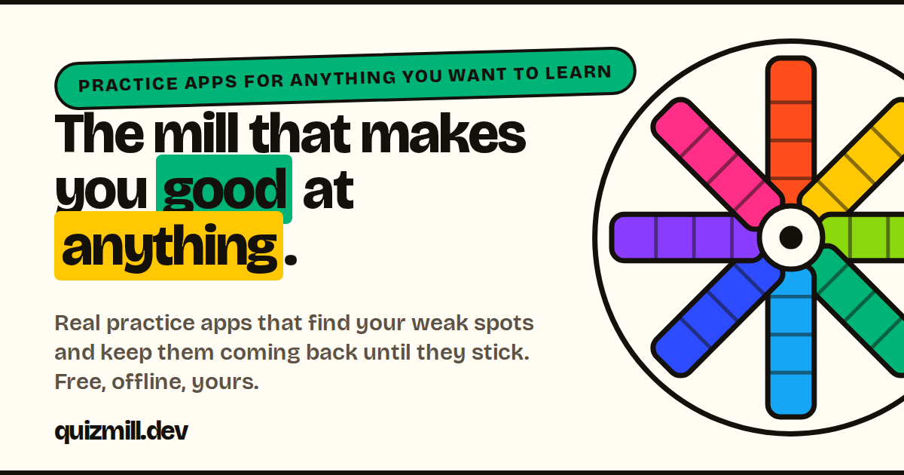

<p align="center">
  <a href="https://quizmill.dev"></a>
</p>

<h3 align="center">The mill that grinds questions into knowledge.</h3>

<p align="center">
  An open-source engine that turns a folder of JSON into a fast, installable, offline-first practice app —<br>
  and a growing shelf of learning packs to run on it.
</p>

<p align="center">
  <a href="https://quizmill.dev"><b>quizmill.dev</b></a> ·
  <a href="https://github.com/quizmill/quizmill">Engine</a> ·
  <a href="https://github.com/quizmill/quizmill#build-a-pack-about-anything">Build a pack</a> ·
  <a href="https://www.npmjs.com/package/quizmill">npm</a>
</p>

---

### ⚙️ How it works

Bring a **learning pack** — a small directory of JSON describing a question bank, written by you or by your AI agent — and quizmill turns it into a practice app: sessions biased toward what you haven't seen, a mistakes queue that re-asks what you got wrong until it sticks, per-question feedback, and optional cross-device sync.

```sh
npx quizmill new my-topic     # scaffold a pack (or ask your agent to fill it)
npx quizmill run my-topic     # practice at localhost:3000
npx quizmill build my-topic   # static app — deploy anywhere
```

With [Claude Code](https://claude.com/claude-code), the bundled `create-learning-pack` skill means you can just say *"make me a learning pack about Kubernetes networking"*.

### 📚 Learning packs

Run any of these with `npx quizmill run quizmill/<pack>`, or try them in the browser.

| Pack | Topic | Try it |
|---|---|---|
| [pack-claude-cert](https://github.com/quizmill/pack-claude-cert) | Claude Certified Architect — Foundations (unofficial) | [▶ play](https://claude-cert.quizmill.dev) |
| [pack-claude-cert-pro](https://github.com/quizmill/pack-claude-cert-pro) | Claude Certified Architect — Professional (unofficial) | [▶ play](https://claude-cert-pro.quizmill.dev) |
| [pack-aws-clf](https://github.com/quizmill/pack-aws-clf) | AWS Cloud Practitioner (CLF-C02) | [▶ play](https://aws-clf.quizmill.dev) |
| [pack-aws-aif](https://github.com/quizmill/pack-aws-aif) | AWS AI Practitioner (AIF-C01) | |
| [pack-aws-saa](https://github.com/quizmill/pack-aws-saa) | AWS Solutions Architect – Associate (SAA-C03) | |
| [pack-aws-arch-pro](https://github.com/quizmill/pack-aws-arch-pro) | AWS Solutions Architect – Professional (SAP-C02) | [▶ play](https://aws-arch-pro.quizmill.dev) |
| [pack-aws-genai](https://github.com/quizmill/pack-aws-genai) | AWS Generative AI Developer – Professional (AIP-C01) | [▶ play](https://aws-genai.quizmill.dev) |
| [pack-world-capitals](https://github.com/quizmill/pack-world-capitals) | Capitals of the world | [▶ play](https://world-capitals.quizmill.dev) |
| [pack-music-theory](https://github.com/quizmill/pack-music-theory) | Music theory, with notation visuals | |
| [pack-running](https://github.com/quizmill/pack-running) | Ultrarunning training theory | |
| [pack-eleven-plus-sample](https://github.com/quizmill/pack-eleven-plus-sample) | 11+ practice, Years 4–6 (sample) | |

Packs are private by default — a private repo installs exactly the same way for anyone whose `git clone` works.

---

<p align="center">
  <br>
  <sub>Answer, review, retry. The engine is the wheel; packs are the grist.</sub>
</p>
